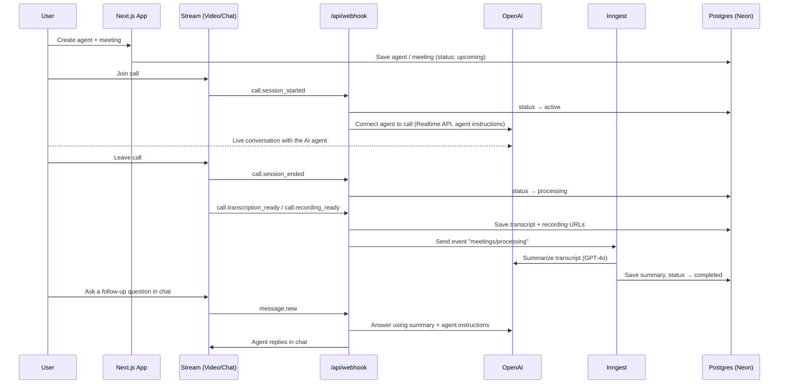

# Meet AI

A video-calling app where you meet with **AI agents** you design. Create an agent with custom instructions, start a meeting, and talk to it live over video. When the call ends, Meet AI transcribes it, writes a summary, and lets you keep chatting with the agent about what was discussed.

Built with **Next.js 15**, **React 19**, **tRPC**, **Drizzle ORM**, **Stream Video & Chat**, **OpenAI** and **Inngest**.

---

## Table of Contents

- [Features](#features)
- [Tech Stack](#tech-stack)
- [How It Works](#how-it-works)
- [Getting Started](#getting-started)
  - [Prerequisites](#prerequisites)
  - [1. Clone and install](#1-clone-and-install)
  - [2. Configure environment variables](#2-configure-environment-variables)
  - [3. Set up the database](#3-set-up-the-database)
  - [4. Configure third-party services](#4-configure-third-party-services)
  - [5. Run the app](#5-run-the-app)
- [Scripts](#scripts)
- [Project Structure](#project-structure)
- [Data Model](#data-model)
- [Free vs. Premium](#free-vs-premium)
- [Deployment](#deployment)
- [Troubleshooting](#troubleshooting)
- [Acknowledgements](#acknowledgements)

---


## Features

- 🤖 **Custom AI agents**: give each agent a name and a set of instructions that shape how it behaves on a call.
- 📞 **Real-time video calls**: talk with your agent live, using Stream Video and the OpenAI Realtime API.
- 📝 **Automatic transcripts and recordings**: every call is recorded and transcribed.
- 🧠 **AI meeting summaries**: an Inngest background job uses GPT-4o to produce an overview and timestamped notes.
- 💬 **Post-meeting chat**: ask the agent follow-up questions about a finished meeting. Answers are grounded in the summary.
- 🔍 **Transcript search**: search the transcript with highlighted matches, and play back the recording.
- 🗂️ **Meeting lifecycle**: meetings move through `upcoming → active → processing → completed` (or `cancelled`).
- 🔐 **Authentication**: email/password, GitHub and Google via Better Auth.
- 💳 **Subscriptions**: a free tier with limits, plus paid plans through Polar (checkout and customer portal).
- 🔎 **Filtering and pagination**: filter meetings and agents by search term, status and agent. Filters live in the URL.
- ⌨️ **Command palette**: jump to agents and meetings quickly.
- 📱 **Responsive UI**: works on mobile and desktop, built with shadcn/ui and Tailwind CSS v4.

---


## Tech Stack


| Layer              | Technology                                                                                                |
| ------------------ | --------------------------------------------------------------------------------------------------------- |
| Framework          | [Next.js 15](https://nextjs.org/) (App Router), [React 19](https://react.dev/)                            |
| Language           | TypeScript                                                                                                |
| Styling / UI       | [Tailwind CSS v4](https://tailwindcss.com/), [shadcn/ui](https://ui.shadcn.com/) (Radix UI), lucide-react |
| API                | [tRPC v11](https://trpc.io/) + [TanStack Query](https://tanstack.com/query)                               |
| Database           | [Neon](https://neon.tech/) (serverless Postgres) + [Drizzle ORM](https://orm.drizzle.team/)               |
| Auth               | [Better Auth](https://www.better-auth.com/)                                                               |
| Video & Chat       | [Stream Video](https://getstream.io/video/) and [Stream Chat](https://getstream.io/chat/)                 |
| AI                 | [OpenAI](https://platform.openai.com/) (Realtime API for live calls, GPT-4o for summaries and chat)       |
| Background jobs    | [Inngest](https://www.inngest.com/) + Inngest Agent Kit                                                   |
| Payments           | [Polar](https://polar.sh/)                                                                                |
| Forms / validation | React Hook Form + Zod                                                                                     |
| URL state          | nuqs                                                                                                      |


---


## How It Works




---


## Getting Started


### Prerequisites

- **Node.js 22 or newer** (22 LTS recommended; an `.nvmrc` is included) and npm
- Accounts or API keys for:
  - [Neon](https://neon.tech/) (or any PostgreSQL database)
  - [Stream](https://getstream.io/) (Video and Chat)
  - [OpenAI](https://platform.openai.com/), with Realtime API access
  - [Polar](https://polar.sh/) (the sandbox is enough for development)
  - Optional: GitHub and Google OAuth apps, for social login
- [ngrok](https://ngrok.com/) with a **static domain**, so Stream can reach your local webhook
- The Inngest Dev Server (run with `npx`, no install needed)


### 1. Clone and install

```bash
git clone https://github.com/<your-username>/meet-ai.git
cd meet-ai

# --legacy-peer-deps is required because some packages don't declare React 19 support yet
npm install --legacy-peer-deps
```


### 2. Configure environment variables

Copy the example file and fill in the values:

```bash
cp .env.example .env
```


| Variable                                                       | Description                                                                               |
| -------------------------------------------------------------- | ----------------------------------------------------------------------------------------- |
| `DATABASE_URL`                                                 | Postgres connection string (for example from Neon)                                        |
| `BETTER_AUTH_SECRET`                                           | A random secret for Better Auth (`openssl rand -base64 32`)                               |
| `BETTER_AUTH_URL`                                              | Base URL of the app (`http://localhost:3000` locally)                                     |
| `GITHUB_CLIENT_ID` / `GITHUB_CLIENT_SECRET`                    | GitHub OAuth app credentials                                                              |
| `GOOGLE_CLIENT_ID` / `GOOGLE_CLIENT_SECRET`                    | Google OAuth client credentials                                                           |
| `NEXT_PUBLIC_APP_URL`                                          | Public URL of the app                                                                     |
| `NEXT_PUBLIC_STREAM_VIDEO_API_KEY` / `STREAM_VIDEO_SECRET_KEY` | Stream Video API key and secret                                                           |
| `NEXT_PUBLIC_STREAM_CHAT_API_KEY` / `STREAM_CHAT_SECRET_KEY`   | Stream Chat API key and secret                                                            |
| `OPENAI_API_KEY`                                               | OpenAI API key                                                                            |
| `POLAR_ACCESS_TOKEN`                                           | Polar organization access token (sandbox)                                                 |
| `NGROK_DOMAIN`                                                 | Your ngrok static domain, e.g. `your-name.ngrok-free.app` (used by `npm run dev:webhook`) |


> ⚠️ Never commit your `.env` file. It is already listed in `.gitignore`.


### 3. Set up the database

Push the Drizzle schema to your database:

```bash
npm run db:push
```

To browse your data, run `npm run db:studio`.

### 4. Configure third-party services

**OAuth callback URLs**

- GitHub: `http://localhost:3000/api/auth/callback/github`
- Google: `http://localhost:3000/api/auth/callback/google`

**Stream webhook**

1. Install ngrok and connect it to your account with `ngrok config add-authtoken <token>`.
2. Claim your free static domain in the ngrok dashboard (**Domains**) and set it in `.env`:
  ```
   NGROK_DOMAIN="your-static-domain.ngrok-free.app"
  ```
3. In the Stream dashboard, set the webhook URL for **both Video and Chat** to:
  ```
   https://your-static-domain.ngrok-free.app/api/webhook
  ```

**Polar**

- Create one or more **recurring** products in your Polar sandbox organization. They will appear on the `/upgrade` page.
- The Polar client is set to `server: "sandbox"` in `src/lib/polar.ts`. Change this to production when you go live.


### 5. Run the app

Start these three processes, each in its own terminal:

```bash
npm run dev
```

```bash
npm run dev:webhook
```

```bash
npm run dev:inngest
```

> The Inngest CLI is pinned to `1.6.3`. Newer CLI versions reject the Inngest SDK version this project uses (`sdk_version_denied`).

Then open [http://localhost:3000](http://localhost:3000). The root URL redirects to `/meetings`.

---


## Scripts


| Command               | Description                                                      |
| --------------------- | ---------------------------------------------------------------- |
| `npm run dev`         | Start the Next.js dev server                                     |
| `npm run dev:webhook` | Expose port 3000 through ngrok (uses `NGROK_DOMAIN` from `.env`) |
| `npm run dev:inngest` | Start the Inngest Dev Server (pinned to v1.6.3)                  |
| `npm run build`       | Build for production                                             |
| `npm run start`       | Start the production server                                      |
| `npm run lint`        | Run ESLint                                                       |
| `npm run db:push`     | Push the Drizzle schema to the database                          |
| `npm run db:studio`   | Open Drizzle Studio                                              |


---


## Project Structure

```
src/
├── app/
│   ├── (auth)/              # Sign-in / sign-up pages
│   ├── (dashboard)/         # Agents, meetings, upgrade pages
│   ├── call/[meetingId]/    # Live call page
│   └── api/
│       ├── auth/[...all]/   # Better Auth handler
│       ├── trpc/[trpc]/     # tRPC handler
│       ├── inngest/         # Inngest function endpoint
│       └── webhook/         # Stream Video & Chat webhooks
├── components/              # Shared components + shadcn/ui primitives
├── db/                      # Drizzle client and schema
├── hooks/                   # Shared React hooks
├── inngest/                 # Inngest client and background functions
├── lib/                     # Auth, Polar, Stream, avatar and other helpers
├── modules/                 # Feature modules (agents, meetings, call, auth, dashboard, premium)
│   └── <feature>/
│       ├── server/          # tRPC procedures
│       ├── ui/components/   # Feature components
│       ├── ui/views/        # Page-level views
│       └── schemas.ts, types.ts, params.ts
└── trpc/                    # tRPC init, routers, client/server helpers
```

---


## Data Model


| Table                                        | Purpose                                                                                                   |
| -------------------------------------------- | --------------------------------------------------------------------------------------------------------- |
| `user`, `session`, `account`, `verification` | Managed by Better Auth                                                                                    |
| `agents`                                     | AI agents: `name`, `instructions`, owner `userId`                                                         |
| `meetings`                                   | Meetings: `name`, `agentId`, `status`, `startedAt`, `endedAt`, `transcriptUrl`, `recordingUrl`, `summary` |


Meeting status is one of `upcoming`, `active`, `processing`, `completed` or `cancelled`.

---


## Free vs. Premium

The free-tier limits are defined in `src/modules/premium/constants.ts`:


|          | Free | Premium           |
| -------- | ---- | ----------------- |
| Agents   | 1    | Based on the plan |
| Meetings | 3    | Based on the plan |


The limits are enforced by `premiumProcedure` in `src/trpc/init.ts`, which checks the user's active Polar subscriptions.

---


## Deployment

The app can be deployed to [Vercel](https://vercel.com/) or any platform that supports Next.js.

1. Add all environment variables to your hosting provider, and set `BETTER_AUTH_URL` and `NEXT_PUBLIC_APP_URL` to your production URL.
2. Point the Stream Video and Chat webhooks at `https://<your-domain>/api/webhook`.
3. Connect [Inngest Cloud](https://www.inngest.com/docs/deploy) to `https://<your-domain>/api/inngest`.
4. Update your OAuth callback URLs to the production domain.
5. Switch Polar from `sandbox` to production in `src/lib/polar.ts` and use a production access token.

---


## Troubleshooting

- `npm install` **fails with peer dependency errors**: install with `npm install --legacy-peer-deps`.
- `TypeError: localStorage.getItem is not a function`: newer Node versions (25+) ship a built-in `localStorage` that breaks Next.js 15 on the server. The `dev`, `build` and `start` scripts already pass `--no-experimental-webstorage` to avoid this. If you run `next` directly, add `NODE_OPTIONS=--no-experimental-webstorage`, or use Node 22 LTS.
- **Inngest shows** `sdk_version_denied`: use the pinned CLI (`npm run dev:inngest`) instead of `inngest-cli@latest`.
- `ERR_NGROK_334` **(endpoint already online)**: another ngrok tunnel is already running with your domain. Stop it, or just keep using it.
- **The agent never joins the call**: check that ngrok is running, the Stream webhook URL is correct, and your OpenAI key has Realtime API access.
- **A meeting stays in** `processing`: make sure the Inngest Dev Server is running, and check its dashboard (usually `http://localhost:8288`) for failed runs.
- **The upgrade page is empty**: create at least one recurring, non-archived product in Polar.

---


## Acknowledgements

Built by Ayush Patel.